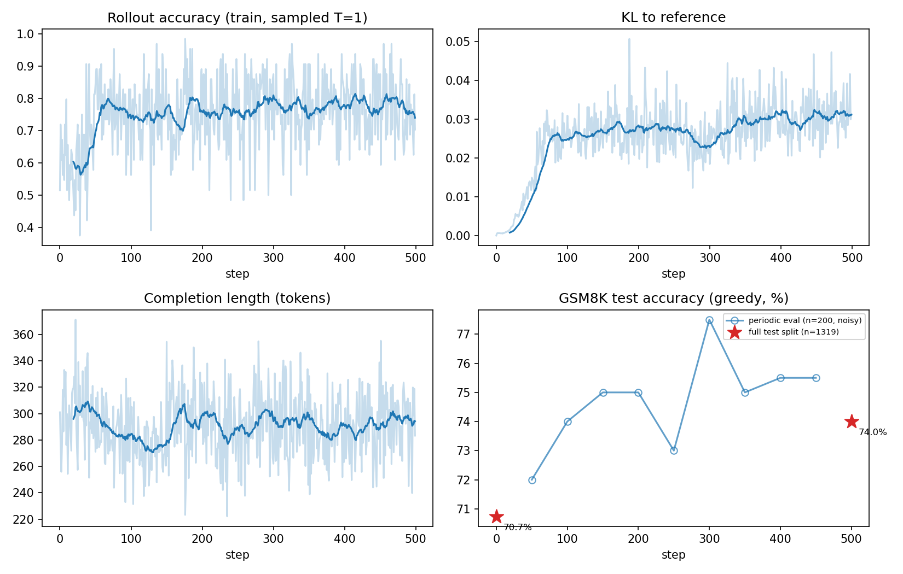

# grpo-from-scratch-gsm8k — GRPO from scratch, gated by a free verifier

A minimal, from-scratch **GRPO** (Group Relative Policy Optimization) implementation
that teaches a small LLM to solve grade-school math (GSM8K), with the policy update
driven entirely by a **free verifier** (answer-checking).

**Result:** Qwen2.5-1.5B-Instruct + LoRA, 500 steps on one RTX 4090 (~5 h):
GSM8K test accuracy **70.7 % → 74.0 %** (full 1,319-question split, greedy; single run —
see [Results](#results) and [Limitations](#limitations)).

## Why this, why now

The guiding principle (from the journey that led here): **RL cannot create
information — it can only amplify a reward signal into a dense value/discriminator.**
So the only place "compute → capability" genuinely works is where a *cheap, reliable
verifier* exists. Math is the canonical case: the answer is either right or wrong,
checkable for free, infinitely. That free oracle is the entire reason RL works here.

So this repo is deliberately built around the verifier (`src/reward.py`) as the soul,
not the RL algorithm.

## The three pieces that matter (read these)

1. `src/reward.py`  — **the verifier.** Extract the model's answer, compare to gold,
   reward = 1.0 if correct else 0.0. The free oracle.
2. `src/grpo.py`    — **group-relative advantage + the GRPO loss.** For each prompt we
   sample G completions; advantage = how much better than the group average this
   completion's reward is. No value network needed — the *group* is the baseline.
3. `src/train.py`   — **the loop:** sample → verify → advantage → policy-gradient step.

## Method in one paragraph

For each prompt q, sample a group of G completions o₁…o_G from the current policy.
Score each with the verifier → rewards r₁…r_G. The group-relative advantage is
Aᵢ = (rᵢ − mean(r)) / (std(r) + ε): completions that beat their group's average get
pushed up, below-average ones pushed down. The policy is updated with the PPO clipped
surrogate using these advantages, plus a KL penalty toward a frozen reference (the base
model with the LoRA adapter disabled) so it doesn't drift off the rails.

## Setup

```bash
pip install -r requirements.txt
python -m src.train --config config.yaml
```

Model: `Qwen2.5-1.5B-Instruct` + LoRA (single model is BOTH policy [adapter on] and
reference [adapter off] — no second copy). Fits a 24 GB RTX 4090.

## What to watch

- `reward` / `acc` — mean group reward and rollout accuracy. Should climb.
- `kl` — KL to reference. Should stay small (a few × 1e-2); spiking = drifting.
- `len` — completion length. Often grows as the model learns to reason more.
- eval accuracy on held-out GSM8K test every `eval_every` steps — the real signal.

## Results

One run, seed 42, 500 GRPO steps (8 prompts × 8 samples per step, LoRA r=16, lr 2e-5, KL β=0.04),
about 5 hours on a single RTX 4090. Raw logs are in [`logs/`](logs/) (`train_log.csv`, `eval_log.csv`,
`results.json`); regenerate the figure with `python scripts/plot.py --log_dir logs`.

| | GSM8K test accuracy (greedy, full split, n = 1,319) |
|---|---|
| `Qwen2.5-1.5B-Instruct` (before training) | 70.7 % |
| After 500 GRPO steps | **74.0 %** (+3.3 points) |



What the curves show:

- Rollout reward (sampled at T = 1) rose from ≈ 0.60 to ≈ 0.77 within the first ~100 steps, then plateaued.
- KL to the reference policy rose to ≈ 0.03 and stayed there; completion length stayed at ≈ 290 tokens
  (the policy did not drift or learn to ramble).
- The mid-run test evals use only the first 200 test questions and are noisy (± ~3 points), so
  individual points should not be read as a trend. Only the step-0 and final numbers use the full split.

## Limitations

- **Single run, single seed.** The +3.3-point gain is about 1.9 standard errors of an unpaired comparison
  (≈ 1.7 points), so it is a modest, plausible improvement, not a tightly measured one.
  Multiple seeds and a paired significance test would be the next step.
- The answer extractor falls back to the last number in the completion when no `\boxed{}` is present, so the
  reward also credits correct answers in the wrong format; part of the gain may be format compliance rather
  than better reasoning. A format-only ablation would separate the two.
- With `inner_epochs: 1` the PPO ratio is exactly 1, so clipping never triggers (`clip% = 0`); the update is
  effectively REINFORCE with a group-relative baseline.
- No hyper-parameter search; lr, β and group size were set once.
